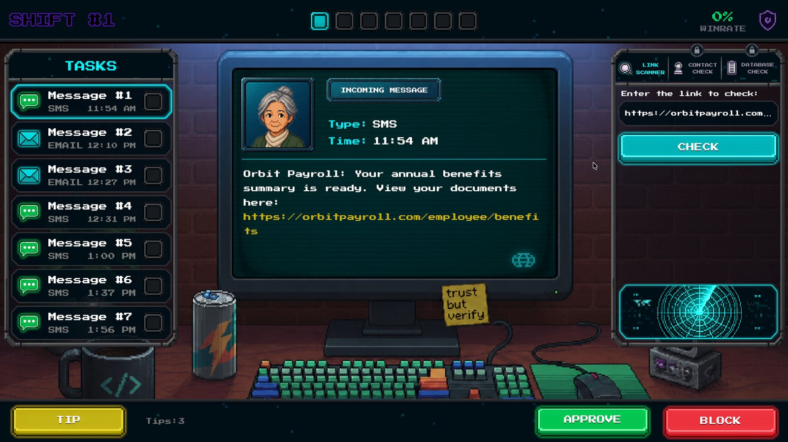
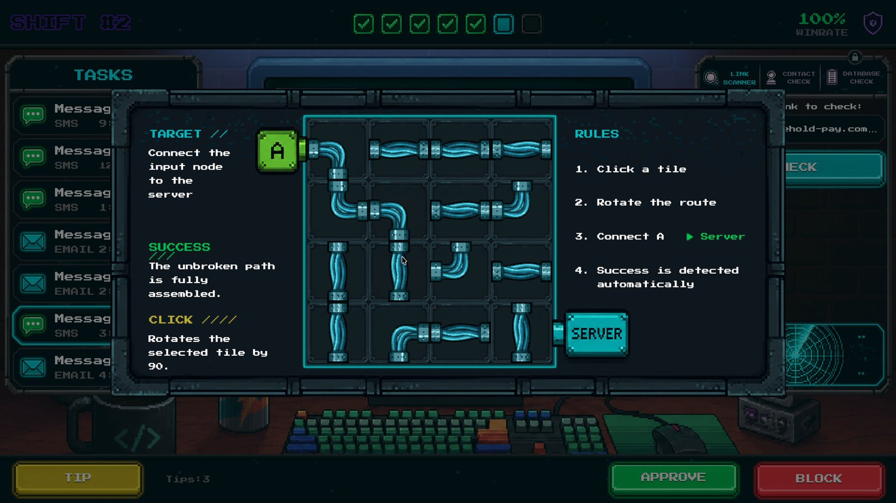
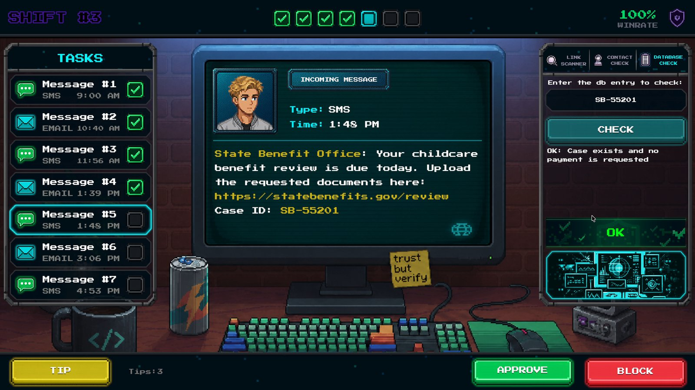
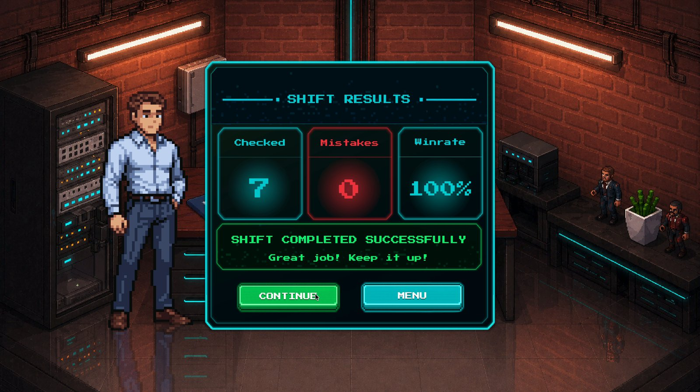

# Antifraud Hero

A pixel-art point-and-click game about spotting fraud, inspired by
*Papers, Please*. You play an operator at a verification desk: incoming
messages, calls, and transactions arrive one by one, and you decide which are
legitimate and which are scams — using the same checks a real person should use.

| Gameplay | Tutorial |
| --- | --- |
|  |  |

| Database check (unlocks later in a shift) | Shift results |
| --- | --- |
|  |  |

## How it plays

- **Structure:** 3 levels of 7 cases (21 in the MVP), from straightforward to
  borderline.
- **Case types:** bank phishing with domain clones, "Mom, I'm in trouble"
  urgency transfers, fake government fines, false advertising — and legitimate
  requests that deliberately look suspicious.
- **Verification tools unlock progressively** as you level up: link scanner →
  recipient/contact check → official database lookup. Select a piece of text,
  press *Check*, and the tool highlights matches in red or green with a short
  result.
- **Verdicts:** confirm or block each case; every decision scores ±1 and comes
  with brief feedback explaining why it was right or wrong.
- **"Clarify" hint booster** (limited per level) highlights suspicious elements
  inside the case without deciding for you.
- **Localization:** Russian and English (Russian by default), plus sound and
  music settings.

## Technology

- Built with **Unity 6**, pixel-art style.
- Case content is **data-driven**: scenarios are defined in config files, not
  hardcoded, which keeps adding new cases a content task rather than a code
  change.
- The game ships as a **WebGL build** and is also published as part of the
  [DiScammer](https://github.com/FomaMol/discammer) anti-scam learning
  platform at `/play/`.

## Repository layout

```
AntifraudProject/     Unity project (scenes, scripts, pixel-art assets)
antifraud-game-docs/  Game design document and task breakdown; screenshots
```
